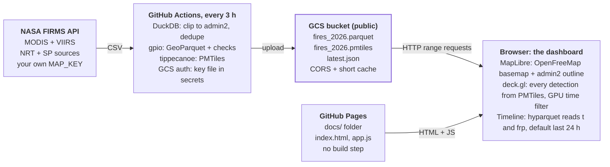

# Daily Fire Dashboard — Course Build Plan

Oct 30, 2026 · @Ujaval Gandhi

## What participants build

Each participant ends with a live dashboard of every fire detection in one admin2 district for 2026, refreshed every 3 hours, running on their own accounts and API keys.

It opens on the last 24 hours. A timeline below the map shows daily counts from 1 January 2026 to today; dragging across it filters the map instantly. Points are drawn individually, coloured by fire radiative power, with no aggregation.



The bucket is the hinge: the job only writes to it, the site only reads from it, so the two halves can be taught and debugged separately.

## Stack, accounts and repo layout

Every participant needs three accounts and six local tools; nothing runs on a server they manage.

| Layer | Tool | Role in the build |
| --- | --- | --- |
| Boundary | FieldMaps edge-matched admin2, open edition (geoBoundaries, CC BY 4.0) | Admin2 polygon for the AOI, read straight from cloud GeoParquet |
| Source | NASA FIRMS area API | MODIS + VIIRS detections, near-real-time (NRT) and science-quality (SP) |
| Processing | DuckDB (CLI + Python) | Read CSVs, normalise schemas, clip to the polygon, dedupe |
| Processing | gpio (geoparquet-io) | GeoParquet best practice (zstd, bbox, Hilbert), checks, PMTiles via tippecanoe |
| Storage | Google Cloud Storage | Public bucket serving `.parquet` and `.pmtiles` with HTTP range requests |
| Automation | GitHub Actions | Scheduled refresh, auth to GCS with a service account key in GitHub secrets |
| Map | MapLibre GL JS + deck.gl | Basemap + GPU-filtered fire points |
| Tiles | PMTiles JS | Reads tiles from one static file |
| Timeline | hyparquet | Reads two columns of the GeoParquet for the daily histogram |
| Hosting | GitHub Pages | Static site, no build step |

**Accounts:** GitHub, NASA Earthdata/FIRMS (free MAP\_KEY), Google Cloud project with billing enabled. Storage for one district costs cents a month.

**Local tools:** Miniforge (conda). One `environment.yml` in the repo installs Python 3.12, DuckDB (Python + CLI), tippecanoe, gcloud and gpio, so every participant and the GitHub Actions runner get the same versions. A local web server comes free with Python (`python -m http.server`).

**Repo layout** (shipped as a GitHub template repo participants copy):

```
fire-dashboard/
  environment.yml        # conda env, shared by laptops and CI
  config.yaml            # AOI name, bucket, year
  pipeline/
    aoi.sql              # Module 1: pull the admin2 polygon
    fetch.py             # Module 3: FIRMS API -> raw CSVs
    build.sql            # Module 4: clean, clip, dedupe
    build.sh             # Module 4-5: gpio convert + PMTiles
    update.py            # Module 7: incremental refresh
  docs/                  # the site (GitHub Pages serves /docs)
    index.html
    app.js  timeline.js  config.js
  .github/workflows/
    update-fires.yml     # Module 7
  data/                  # gitignored; never commit data
```

## Build steps

Eleven modules, each ending in a checkpoint participants can verify themselves before moving on. Modules 0-7 build the whole backend, including the scheduled refresh; 8-10 build and host the dashboard on top of live data. Code below is a teaching sketch to be finalised in the template repo.

### Module 0: Set up

1. Create the repo from the template and clone it.
2. Install Miniforge (conda with conda-forge as the default channel).
3. Create the environment from the repo's `environment.yml` and activate it:

```yaml
name: fire-dashboard
channels: [conda-forge]
dependencies:
  - python=3.12
  - python-duckdb
  - duckdb-cli
  - tippecanoe
  - google-cloud-sdk
  - pip
  - pip:
      - geoparquet-io
```

```
conda env create -f environment.yml
conda activate fire-dashboard
```

4. Run `duckdb --version`, `gpio --help`, `tippecanoe --version`, `gcloud --version`.

**Checkpoint:** all four commands print a version.

### Module 1: Pick the area of interest

Pull the admin2 polygon from the FieldMaps edge-matched global file with DuckDB. Neighbouring districts share edges exactly, which matters if participants later combine AOIs. Start by looking at the columns:

```sql
INSTALL spatial; LOAD spatial; INSTALL httpfs; LOAD httpfs;
CREATE VIEW adm2 AS
  SELECT * FROM 'https://data.fieldmaps.io/edge-matched/open/intl/adm2_polygons.parquet';
DESCRIBE adm2;
SELECT adm0_name, adm1_name, adm2_name FROM adm2 WHERE adm2_name ILIKE 'sangrur%';
```

Then save one polygon (Sangrur, Punjab is a good default: peak stubble burning in Oct-Nov):

```sql
COPY (SELECT * FROM adm2
      WHERE adm0_name = 'India' AND adm1_name = 'Punjab' AND adm2_name = 'Sangrur')
TO 'data/aoi.parquet' (FORMAT parquet);
SELECT ST_XMin(geometry), ST_YMin(geometry), ST_XMax(geometry), ST_YMax(geometry)
FROM 'data/aoi.parquet';
```

Write the bbox into `config.yaml`, and `gpio convert data/aoi.parquet docs/aoi.geojson` for the map outline.

**Checkpoint:** `aoi.geojson` opens in QGIS or geojson.io and shows the right district. Teach: confirm column names with `DESCRIBE` before filtering, and carry the CC BY 4.0 attribution for geoBoundaries/FieldMaps into the dashboard's About panel.

### Module 2: Get FIRMS API access

1. Request a MAP\_KEY at `firms.modaps.eosdis.nasa.gov/api/map_key/`. Store it as an environment variable `FIRMS_MAP_KEY`, never in code.
2. Check which sources and date ranges exist: `/api/data_availability/csv/$FIRMS_MAP_KEY/all`.
3. Make one request by hand: `/api/area/csv/$FIRMS_MAP_KEY/VIIRS_NOAA20_NRT/<w,s,e,n>/1` and open the CSV.

**Checkpoint:** a CSV with today's detections (possibly zero rows outside fire season). Teach: SP is science-quality and arrives months later; NRT covers the recent gap. FIRMS guarantees the two ranges don't overlap per sensor.

### Module 3: Fetch 2026 to date

`fetch.py` loops over sensors (MODIS, VIIRS SNPP, NOAA-20, NOAA-21) and 5-day windows from 1 Jan 2026 to today:

1. Read `data_availability` to decide, per sensor, which dates come from `_SP` and which from `_NRT`.
2. Request `/api/area/csv/{key}/{source}/{bbox}/5/{start_date}` for each window. The server rejects day ranges above 5.
3. Save each response as `data/raw/{source}_{start_date}.csv`; skip files that already exist, so reruns resume.

**Checkpoint:** about 60 windows per source in `data/raw/`. Teach: the key allows 5,000 transactions per 10 minutes, and cost scales with area x days, so a district-sized bbox fits easily while a country would not.

### Module 4: Clean, clip and write GeoParquet

`build.sql` normalises the two CSV schemas (MODIS confidence is 0-100, VIIRS is l/n/h; brightness columns differ), clips to the polygon, and drops duplicates:

```sql
LOAD spatial;
COPY (
  WITH raw AS (
    SELECT * FROM read_csv('data/raw/*.csv', union_by_name = true,
                           all_varchar = true, filename = true))
  SELECT
    latitude::DOUBLE AS lat, longitude::DOUBLE AS lon,
    acq_date::DATE AS acq_date,
    strptime(acq_date || lpad(acq_time, 4, '0'), '%Y-%m-%d%H%M') AS acq_ts,  -- UTC
    ((epoch(acq_ts) - epoch(TIMESTAMP '2026-01-01')) / 60)::INT AS t,         -- minutes into 2026
    satellite, instrument, confidence, frp::DOUBLE AS frp, daynight,
    regexp_extract(filename, '_(NRT|SP)_', 1) AS quality
  FROM raw, 'data/aoi.parquet' a
  WHERE ST_Within(ST_Point(lon, lat), a.geometry)
  QUALIFY row_number() OVER (PARTITION BY lat, lon, acq_ts, satellite) = 1
) TO 'data/fires_flat.parquet';
```

Then let gpio add the GeoParquet best practices and check the result:

```
gpio convert geoparquet data/fires_flat.parquet data/fires_2026.parquet --lat-column lat --lon-column lon
gpio check all data/fires_2026.parquet
gpio inspect data/fires_2026.parquet
```

**Checkpoint:** `gpio check` passes, and a row count by month in DuckDB shows the Oct-Nov peak. Teach: `t` is an integer so the browser can filter on the GPU later.

### Module 5: Make PMTiles

Start with gpio, then look at what happens to points at low zoom:

```
gpio pmtiles create data/fires_2026.parquet data/fires_2026.pmtiles -l fires \
  --min-zoom 6 --max-zoom 12 --include-cols t,frp,confidence,satellite,daynight
```

Open the file in the pmtiles.io viewer and compare point counts at z6 and z12. tippecanoe thins points at lower zooms by default. Since this course renders every detection, rebuild with no dropping:

```
gpio convert geojson data/fires_2026.parquet | \
  tippecanoe -o data/fires_2026.pmtiles -l fires -Z6 -z12 -r1 --no-tile-size-limit --force -P
```

**Checkpoint:** the same point count at every zoom in the viewer.

### Module 6: Publish to Google Cloud Storage

```
gcloud storage buckets create gs://$BUCKET --location=asia-south1 --uniform-bucket-level-access
gcloud storage buckets add-iam-policy-binding gs://$BUCKET --member=allUsers --role=roles/storage.objectViewer
gcloud storage buckets update gs://$BUCKET --cors-file=cors.json
gcloud storage cp data/fires_2026.parquet data/fires_2026.pmtiles gs://$BUCKET/sangrur/ \
  --cache-control="public, max-age=300"
```

`cors.json` must allow range reads from the browser:

```json
[{"origin": ["*"], "method": ["GET", "HEAD"],
  "responseHeader": ["Range", "Content-Range", "Content-Length", "ETag", "Accept-Ranges"],
  "maxAgeSeconds": 3600}]
```

**Checkpoint:** `curl -sI -H "Range: bytes=0-99" https://storage.googleapis.com/$BUCKET/sangrur/fires_2026.pmtiles` returns `206 Partial Content`.

### Module 7: Automate the refresh

`update.py` keeps the repo stateless:

1. Download the current `fires_2026.parquet` from the bucket.
2. Fetch the last 2 days of each `_NRT` source (catches late-arriving passes).
3. Append, dedupe with the same `QUALIFY` rule, rebuild GeoParquet and PMTiles (Modules 4-5).
4. Upload both files plus `latest.json` (run time, newest detection) for an "updated X minutes ago" label.

Authenticate GitHub to GCS with a service account key file, stored as a GitHub secret:

```
gcloud iam service-accounts create fire-publisher
gcloud storage buckets add-iam-policy-binding gs://$BUCKET \
  --member=serviceAccount:fire-publisher@$PROJECT.iam.gserviceaccount.com --role=roles/storage.objectAdmin
gcloud iam service-accounts keys create key.json \
  --iam-account=fire-publisher@$PROJECT.iam.gserviceaccount.com
gh secret set GCP_SA_KEY < key.json && rm key.json
```

**After the class:** list and delete the key with `gcloud iam service-accounts keys list` / `keys delete`; the scheduled job stops writing until a new key is added. The service account only has object access on one bucket, which limits damage if a key leaks.

**For production dashboards, consider Workload Identity Federation:** each run gets a short-lived token scoped to one repo, so there is no long-lived key to leak or rotate. It is also the only option where an org policy blocks key creation. `google-github-actions/auth` supports both, so switching later changes two lines of the workflow.

In GitHub: secrets `FIRMS_MAP_KEY` and `GCP_SA_KEY`; variable `BUCKET`. The workflow:

```yaml
name: update-fires
on:
  schedule: [{cron: '17 */3 * * *'}]   # every 3 hours, UTC
  workflow_dispatch:
permissions: {contents: read}
jobs:
  update:
    runs-on: ubuntu-latest
    steps:
      - uses: actions/checkout@v4
      - uses: google-github-actions/auth@v2
        with:
          credentials_json: ${{ secrets.GCP_SA_KEY }}
      - uses: google-github-actions/setup-gcloud@v2
      - uses: conda-incubator/setup-miniconda@v3
        with:
          miniforge-version: latest
          environment-file: environment.yml
          activate-environment: fire-dashboard
      - shell: bash -el {0}   # login shell so the conda env is active
        run: python pipeline/update.py
        env:
          FIRMS_MAP_KEY: ${{ secrets.FIRMS_MAP_KEY }}
          BUCKET: ${{ vars.BUCKET }}
```

**Checkpoint:** a manual "Run workflow" goes green and `latest.json` in the bucket shows the new run time.

### Module 8: Build the map

`docs/index.html` loads MapLibre, deck.gl, pmtiles and the MVT loader from unpkg, as plain ES modules with no bundler. The map has three layers:

1. A keyless OpenFreeMap basemap in MapLibre (style URL tiles.openfreemap.org/styles/positron, no API key or sign-up) and the AOI outline from `aoi.geojson`.
2. A deck.gl `TileLayer` whose `getTileData` calls `archive.getZxy(z, x, y)` and decodes the tile with the MVT loader. The FIRMS explorer's `deck.html` is a working reference for this glue.
3. Inside each tile, a `ScatterplotLayer` coloured by FRP, with `DataFilterExtension`: `getFilterValue: f => f.properties.t`, `filterRange: [t0, t1]`.

Default `[t0, t1]` is the 24 hours ending now. Changing it only updates a uniform, so scrubbing never refetches tiles.

**Checkpoint:** `python -m http.server -d docs` shows today's points; widening the range by hand in the console shows more.

### Module 9: Build the timeline

Read only the columns the histogram needs with hyparquet:

```js
import {parquetReadObjects, asyncBufferFromUrl} from 'https://cdn.jsdelivr.net/npm/hyparquet/+esm';
import {compressors} from 'https://cdn.jsdelivr.net/npm/hyparquet-compressors/+esm';
const file = await asyncBufferFromUrl({url: `${DATA}/fires_2026.parquet`});
const rows = await parquetReadObjects({file, columns: ['t', 'frp'], compressors});
```

1. Bucket `t` into days, 1 Jan 2026 to today, and draw one bar per day (SVG or canvas; d3-scale and d3-brush keep it short).
2. A brush sets `[t0, t1]` and pushes it to the deck.gl layer.
3. Preset buttons: 24 h (default), 7 d, 30 d, 2026 to date. Show the count and total FRP for the selection.

**Checkpoint:** dragging the brush filters the map in real time. Teach: `compressors` is required because gpio writes zstd; hyparquet only reads the byte ranges for those two columns.

### Module 10: Host on GitHub Pages

1. Point `docs/config.js` at `https://storage.googleapis.com/$BUCKET/<aoi>/`.
2. Settings, Pages, deploy from branch `main`, folder `/docs`.
3. Share the `https://<user>.github.io/<repo>/` link.

**Checkpoint:** the live site shows the last 24 hours and updates after the next scheduled run without a redeploy.

## Teaching notes

Most participant failures will come from browser access to the bucket and from time handling, not from the geospatial steps.

**Pitfalls to warn about up front**

| Symptom | Cause | Fix |
| --- | --- | --- |
| Map is blank, console shows CORS error | Bucket CORS missing or not exposing range headers | Re-apply `cors.json`; re-test with the `curl` Range check |
| `allUsers` binding refused | Org policy "public access prevention" on Workspace/edu accounts | Use a personal GCP project, or ask the org admin |
| Tiles error right after an update | Browser cached the old PMTiles header, fetched new bytes | Short `max-age` (300 s), or versioned filenames listed in `latest.json` |
| Points vanish when zooming out | tippecanoe drops points below max zoom | `-r1` (Module 5) |
| Detections appear 5.5 h off | FIRMS `acq_time` is UTC | Store UTC, convert to local time only in the UI |
| `read_csv` errors on confidence | MODIS numeric vs VIIRS l/n/h | `all_varchar = true`, cast per column |
| API returns an error for long windows | Area API rejects day ranges above 5 | Fixed 5-day windows in `fetch.py` |
| Scheduled runs stop after a while | GitHub pauses cron in public repos after 60 days with no commits | Manual run or a trivial commit; mention it in the last session |
| Run is late by 10-30 min | GitHub cron is best-effort | Expected; `latest.json` shows the real time |

**Discussion points**

- For one district, the GeoParquet alone is a few MB, and hyparquet plus a `ScatterplotLayer` could render it without PMTiles. Ask participants when PMTiles starts to pay off (a state or a country), then have them try a bigger AOI.
- Why Hilbert ordering and bbox columns matter even for a small file, using `gpio check` output.
- Why the refresh job is stateless (data lives in the bucket, not the repo).
- Key file vs Workload Identity Federation: what a leaked key exposes, and what the WIF `attribute-condition` protects against.

**Fallback for participants without a billing account:** publish the data files into the Pages site itself (still range-readable), or to Source Cooperative. Everything else stays the same.

**Stretch exercises**

- Toggle sensors (MODIS vs VIIRS) with a second filter dimension.
- Size points by FRP; add a day/night split to the timeline.
- Compare the selection against the same dates in 2025.
- Add DuckDB-wasm on demand for ad-hoc queries ("top 10 villages by detections").
- Publish a STAC item for the dataset with `gpio publish`.
